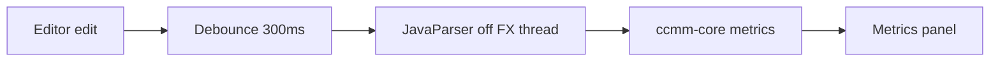
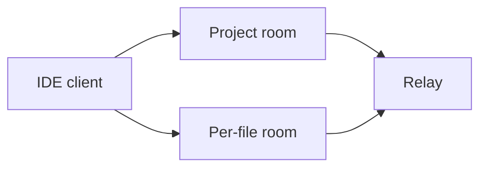
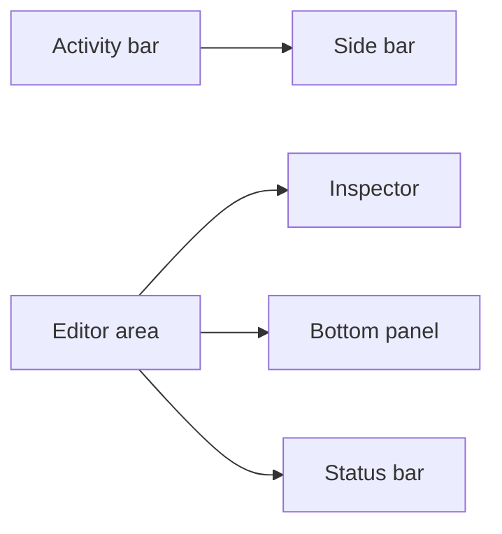

# Architecture

Signature-level design for the modules in `AGENTS.md`. No implementation in this document. Formulas are ADR-0004. Collaboration is ADR-0002.

## Modules

`ccmm-core` parses Java and returns metrics. It does not import JavaFX or know about git.

`ccmm-cli` calls `ccmm-core` for `analyze`, `gate`, and `report`.

`ccmm-collab-protocol` holds the message and text-op types shared by the IDE and the relay. Phase 0 may add tests only.

`ccmm-collab-server` is the WebSocket relay. It depends on the protocol module. Phase 4 only.

`ccmm-app` is the JavaFX shell. It depends on `ccmm-core` and, in Phase 4, the protocol module.

## Core API

```java
public final class Analyzer {
    public AnalysisResult analyze(String source, String relativePath) { /* ... */ }
    public ProjectReport scan(Path projectRoot) { /* ... */ }
}

public sealed interface AnalysisResult {
    record Ok(String relativePath, FileMetrics file) implements AnalysisResult {}
    record Failed(String relativePath, String message) implements AnalysisResult {}
}

public record FileMetrics(
    int physicalLines,
    int codeLines,
    int commentLines,
    int blankLines,
    int cyclomatic,
    int maxLoopNesting,
    Halstead halstead,
    double maintainability,
    List<MethodMetrics> methods) {}

public record MethodMetrics(
    String name,
    int startLine,
    int codeLines,
    int cyclomatic,
    int loopNesting,
    Halstead halstead,
    double maintainability) {}

public record Halstead(
    int uniqueOperators,
    int uniqueOperands,
    int totalOperators,
    int totalOperands,
    int vocabulary,
    int length,
    double volume,
    double difficulty,
    double effort) {}

public record ProjectReport(List<AnalysisResult> files, List<String> skipped) {}
```

`analyze` returns `Failed` for a syntax error. It does not throw that error to the caller. `scan` walks `*.java` under `projectRoot`. A file larger than 1 MiB is listed in `skipped` and is not parsed. Symlinks that leave `projectRoot` are skipped.

`cyclomatic` on a file is the sum of its methods. Halstead on a file is computed on the compilation unit. Maintainability uses the file or method Halstead volume, cyclomatic complexity, and code-line count as in ADR-0004.

## Live metrics



The JavaFX thread updates the scene graph and nothing else. A keystroke resets a 300 ms timer. When the timer fires, the IDE copies the buffer and submits one analysis job. A newer submit cancels the previous job or drops its result (latest wins). The worker calls `Analyzer.analyze`. `Platform.runLater` publishes the result.

If the result is `Failed` and an earlier `Ok` exists for that buffer generation's file, the panel keeps the earlier numbers and shows a stale marker. If there has never been an `Ok`, the panel shows the parse message and no metrics. The failure is not thrown onto the JavaFX thread.

The panel shows, for the file and for the method containing the caret: maintainability index, cyclomatic complexity, code lines, Halstead volume, and loop nesting.

## CLI and gate

```text
ccmm analyze <path> [--format text|json]
ccmm gate --base <git-ref> [--format markdown]
ccmm report <path> [--format markdown]
```

`analyze` and `report` call `Analyzer.scan` or `analyze`. Exit 0 when the command ran, including when individual files are `Failed` (those files are listed). Exit 2 on usage errors.

`gate` reads `.ccmm.yml` from the project root:

```yaml
rules:
  cyclomatic: 10
  maintainability: 20
  nesting: 3
```

`cyclomatic` and `nesting` are maximums. `maintainability` is a minimum. `gate` lists Java files changed versus `--base` and fails (exit 1) when a changed method breaks a rule. Markdown output is what `.github/workflows/quality-gate.yml` already expects. This repository does not contain a `.ccmm.yml`, so that workflow stays skipped until a project adds one.

Missing `.ccmm.yml` is an error for `gate`, not a pass.

## Collaboration

Specified for Phase 4. ADR-0002, ADR-0005, and ADR-0006 are accepted.



The project room carries presence and chat. A per-file room is keyed by the project-relative path and carries text operations. The client joins a file room only after the project room has accepted the invite token from ADR-0006.

A text operation is an insert or delete at a code-unit offset, with the revision the client based it on. The relay orders operations and transforms them. Clients apply remote operations in one batched edit on the JavaFX thread. Undo pops local edits only.

Every path from a peer is checked before use: it must be relative, must not contain `..`, and the normalized real path must stay inside the project root. The relay checks the path text. The IDE also checks the real path against the project root.

Each WebSocket text frame is one JSON object. The `type` field is `join`, `presence`, `chat`, `insert`, or `delete`.

## Packaging

`scripts/package.sh` and `.github/workflows/package.yml` stay as they are. Package-check has already produced unsigned installers for `windows-x64`, `linux-x64`, `macos-arm64`, and `macos-x64`. Signing remains the optional secrets in `docs/RELEASING.md`.

## Workbench (proposed)

The running window is one `BorderPane` owned by `IdeWindow`. The UX program introduces a workbench so metrics and collaboration can decorate a document without each feature editing the scene directly. This section is the target. It does not replace the `Analyzer` signatures above, and the JavaFX thread still does nothing but update the scene.



```java
public final class Workbench {
    public void execute(String commandId) { /* looks up Command and runs it on the FX thread */ }
    public Document activeDocument() { /* ... */ }
    public void show(RegionId region, boolean visible) { /* ... */ }
}

public interface Command {
    String id();
    String title();
    void run(Workbench workbench);
}

public final class Document {
    public String relativePath() { /* project-relative, '/' separators */ }
    public String text() { /* ... */ }
    public boolean dirty() { /* ... */ }
    public void replace(int start, int end, String text, EditOrigin origin) { /* ... */ }
}

public enum EditOrigin { LOCAL, REMOTE }

public enum RegionId { ACTIVITY, SIDE, EDITOR, INSPECTOR, BOTTOM, STATUS }
```

`replace` with `REMOTE` is the batched path that already exists in `RemoteEdits`: one edit on the JavaFX thread, excluded from local undo. `LOCAL` is typing. Analysis still copies the buffer after 300 ms of quiet and calls `Analyzer.analyze` off-thread. Only a `.java` path is analyzed.

Commands and key bindings live in the workbench, not in menu item handlers. The same `Command` is what the palette runs. Bindings use Ctrl on Windows and Linux and Cmd on macOS. Settings (theme, font size, ligatures, relay URL, display name) persist in the OS user-config directory, not in the project.

### Decorations

Gutter chips, remote carets, and comment anchors are decorations on a document. They are not extra copies of the text.

```java
public interface Decoration {
    String documentPath();
    int startOffset();
    int endOffset();
}

public record GutterChip(String documentPath, int startOffset, int endOffset, int cyclomatic, String band, boolean stale)
        implements Decoration {}

public record RemoteCaret(String documentPath, int startOffset, int endOffset, String peerId, String name, int colorIndex)
        implements Decoration {}

public record ThreadAnchor(String documentPath, int startOffset, int endOffset, String threadId)
        implements Decoration {}
```

`band` is a token name (`success`, `warn`, `danger`), not a hex colour. A failed parse keeps the last `GutterChip` values and sets `stale`. Remote carets move when remote ops are applied. They do not scroll the viewport unless this client is following that peer. An anchor is transformed with the same OT as the text (ADR-0002, spike E0-T03).

The inspector, outline, status bar, and problems panel read `AnalysisResult` and these decorations. They do not call the parser themselves.

## Failure modes

| Failure | Result |
|---|---|
| Syntax error while typing | Last good metrics stay, marked stale. No exception dialog. |
| File over 1 MiB, or not UTF-8 | Listed as skipped. Scan continues. |
| Symlink leaves the project root | Skipped. Not parsed and not written by a collaborator. |
| `.ccmm.yml` missing or malformed | `gate` exits with an error. `analyze` does not read it. |
| Relay rejects the invite token | The IDE shows a connection error and does not apply remote edits. |
| Analysis job is overtaken by a newer edit | Its result is discarded. |
